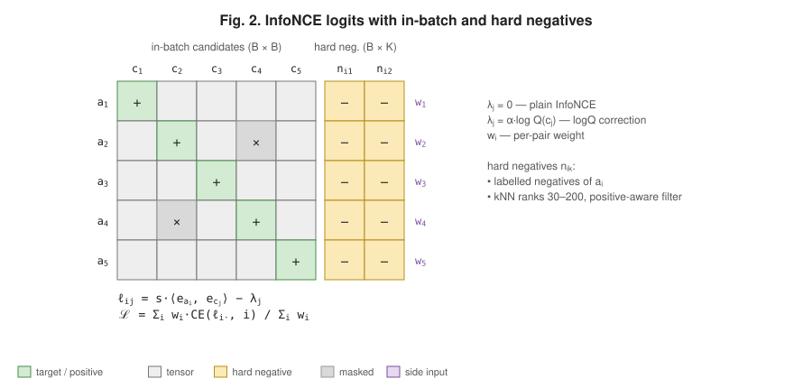

# dl-paper-diagrams

A Claude Code / Agent skill that draws neural-network figures in the style of ML papers. It produces:
- **interactive HTML:** hover for tensor shapes and details, click to trace the data flow, step through the forward pass, filter by tag, export SVG/PNG;
- **static SVG:** for READMEs on GitHub/GitLab, where scripts don't run.




## Install

```bash
git clone https://github.com/Genndoso/dl-paper-diagrams ~/.claude/skills/dl-paper-diagrams
```

Then ask Claude for something like *"draw the architecture of this model like in a paper"*.

## Use without Claude

```bash
python3 scripts/render.py examples/two_tower_lora.json -o out   # out/two_tower_lora.svg + .html
```

The renderer uses the Python standard library only. The spec format is in [references/spec.md](references/spec.md), the workflow and style rules in [SKILL.md](SKILL.md).

## License

MIT
